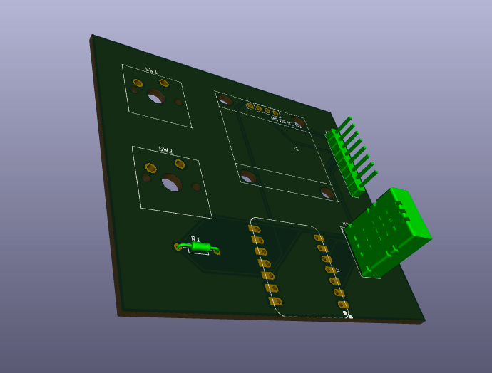
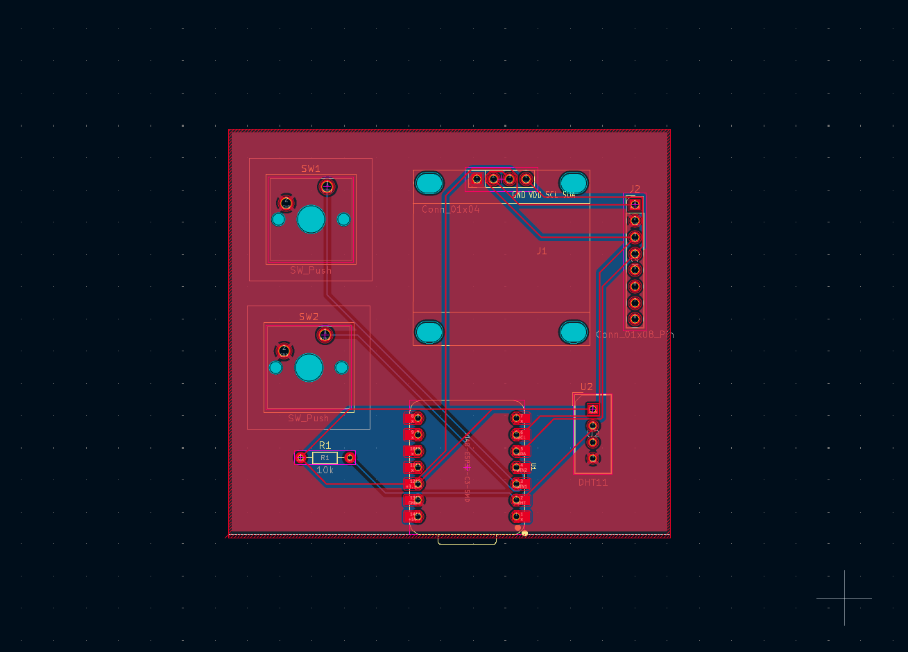
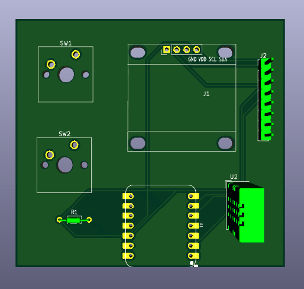
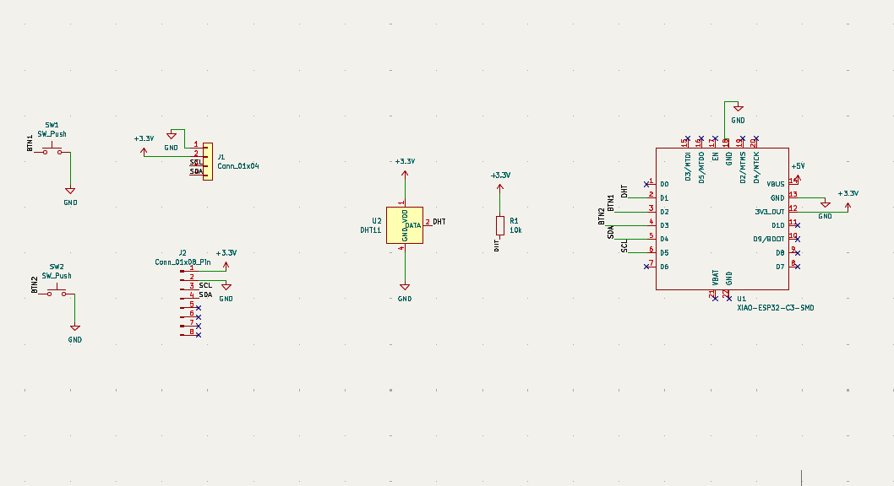

# Squarbie

A square take on Hack Club's Starbie desk pet. XIAO ESP32-C3, 0.96" SSD1306 OLED, MPU6050 (tilt/shake), DHT11 (temp/humidity), and 2 Cherry MX keys.

| PCB | 3D (top) |
| --- | --- |
|  |  |

## Files
- `Starbie1.kicad_pro`, `.kicad_sch`, `.kicad_pcb`: KiCad 10 project
- `lib/`: care-package symbols and footprints
- `gerbers.zip`: fabrication files
- `BOM.md`: parts list

Built for Hack Club Half Life, Week 1.
